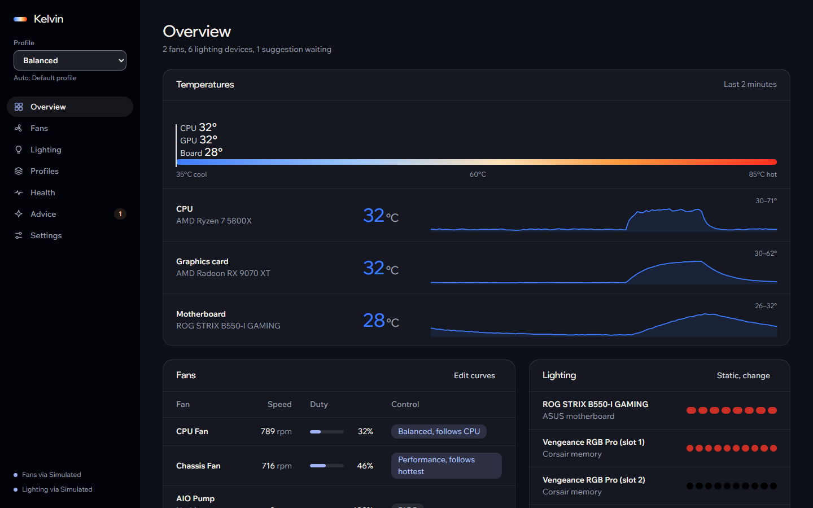
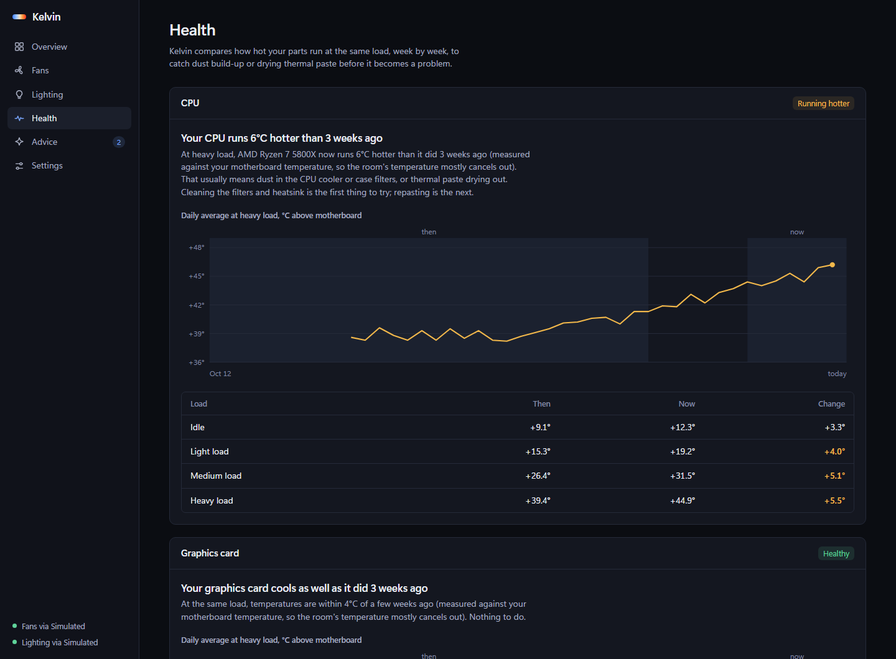
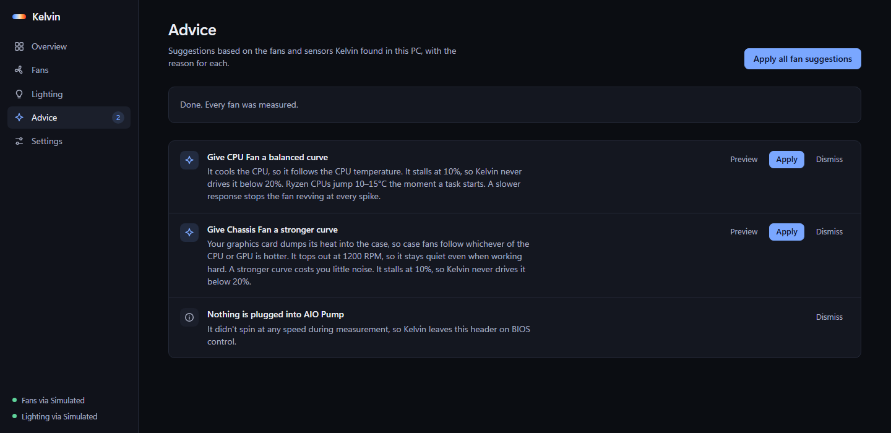

# Kelvin

**One app for your PC's fans and RGB lighting, whatever the brands inside it.**

Kelvin runs your fans on curves you shape by dragging, lights every RGB device from one place, and
switches between setups on its own when you start a game or the evening comes. It replaces the
vendor apps (Armoury Crate, iCUE, Synapse, G HUB and the rest) that fight each other when two of
them run at once.

Free, open source, Windows 10 and 11. No account, and nothing leaves your PC.

**[Download the latest version](https://github.com/nanwer/kelvin/releases/latest)**



## What it does

### Fans

- **Curves you can see.** Each fan runs on BIOS control, a fixed speed, or a temperature curve. Drag
  the points on a chart laid over a cool-to-hot scale and watch the live reading move along it.
- **Calm by design.** Modern CPUs jump 20°C or more for a few seconds whenever a task starts. Kelvin
  follows the average temperature over about 30 seconds (you choose how long), so fans don't rev at
  every spike. A real, lasting rise still gets a response straight away.
- **It measures your fans.** *Measure fans* runs each one from full speed down to a stop in about
  30 seconds and records its real speed range and the point where it stalls.
- **Advice with reasons.** Kelvin turns those measurements into a suggested setup for each fan and
  says why. For example, in a small case the case fan should follow whichever of the CPU and
  graphics card is hotter.

### Lighting

- **Every brand, one effect.** Static, Breathing, Spectrum, **Temperature** (your whole PC shifts
  from blue to red as it heats up) or **Screen sync** (your lights follow the colors on screen).
- **Or go device by device.** Give any device, or any zone inside it (just the mouse's scroll
  wheel, say), its own color or gradient. Turn a device off to leave it to another app.
- **Screen sync stays private.** The app samples your main display about ten times a second and
  keeps only a 16 by 9 grid of colors. Nothing is saved or sent anywhere.

### It adapts by itself

- **Profiles.** Quiet, Balanced, Gaming and Night are each a complete setup: fan curves, lighting
  and, on laptops, the fan mode.
- **Automatic switching.** Kelvin moves to Gaming when a game starts (one you list, or whenever the
  graphics card is busy) and to Night on a schedule. Pick a profile yourself, from the app or the
  tray, and it holds until the situation next changes.
- **Your changes are kept apart.** The four built-in profiles never change. The first time you
  adjust one, Kelvin makes a copy such as *Balanced (custom)* and uses that from then on.

### It watches the PC for you

- **Thermal health.** Kelvin learns how hot your CPU and graphics card run at each load level and
  compares this week with a few weeks ago: *"At heavy load, your CPU runs 6°C hotter than 3 weeks
  ago. That usually means dust or drying thermal paste."* It measures against the motherboard
  sensor, so a hot day doesn't look like dust.
- **Alerts.** Set your own limits ("CPU above 85°C for 10 seconds") and get a Windows notification
  when one is crossed, even with Kelvin in the tray. Each episode notifies once.
- **Conflict detection.** Kelvin spots Armoury Crate, iCUE, Razer Synapse, G HUB, SignalRGB,
  Gigabyte Control Center and FanControl, tells you they're in the way, and can close the lighting
  apps for you.

### Everything else

- **Laptops.** Where a laptop runs its own fans, Kelvin switches its fan mode instead: Quiet,
  Balanced, Performance, and Max fan on HP Omen. It uses the HP Omen, ASUS ROG/TUF and Lenovo
  Legion interfaces where they exist (marked experimental until confirmed on each model) and
  Windows power modes everywhere else.
- **Home Assistant.** Kelvin can publish temperatures, fan speeds and its profile over MQTT and
  shows up as a device of its own. Home Assistant can switch profiles, never fan speeds.
- **A local API** for your own scripts. See [docs/API.md](docs/API.md).
- **Runs in the background.** Kelvin starts with Windows and sits in the tray. Fan curves keep
  running even when the app is closed, because a small Windows service does the work.
- **Updates itself.** Kelvin checks for a new version when it starts and installs it in under a
  minute. Every update is signed, and Kelvin refuses one that isn't.

| Fans | Lighting | Health |
|---|---|---|
|  |  |  |



## Install

1. Download `Kelvin_x.y.z_x64-setup.exe` from the
   [latest release](https://github.com/nanwer/kelvin/releases/latest).
2. Run it. Windows SmartScreen will warn you, because Kelvin isn't code-signed yet: click
   *More info*, then *Run anyway*. Each release lists the installer's SHA-256 so you can check it.
3. Close other fan and RGB apps. Kelvin tells you if any are still running.

The installer sets up everything:

- the Kelvin app and its background service (no separate .NET install);
- [OpenRGB](https://openrgb.org), shipped inside Kelvin and run invisibly for lighting;
- the [PawnIO](https://pawnio.eu) driver for motherboard fans and RAM lighting, downloaded from
  its official release and checked against a pinned checksum.

Installing Kelvin changes nothing by itself: every fan stays on BIOS control until you set it up.

## Safety

Fan control can damage hardware if it goes wrong, so Kelvin fails safe.

- **Too hot means full speed.** If the CPU or graphics card reaches its limit (90°C and 95°C by
  default), every fan Kelvin controls goes to 100% at once, whatever the curve says.
- **If Kelvin stops, the BIOS takes over.** A crash, an update or a lost temperature sensor hands
  that fan back to BIOS control.
- **Curves can't be dangerous.** On save, a curve is corrected so speed never drops as temperature
  rises and the hot end reaches 100%. Each fan has a minimum speed, and Kelvin tells you where
  yours stalls.
- **Graphics card fans are left alone** unless you set them up yourself.
- **Websites can't reach it.** The service listens on this PC only and rejects requests that come
  from a web page.
- **On laptops it doesn't pretend.** Where Kelvin can't control any fans, it says so.

## Privacy

Kelvin has no account and no telemetry. It contacts GitHub to check for updates, and an MQTT
broker only if you set one up. Fonts and everything else ship inside the app.

A hardware report is sent only when you click *Settings → Report my hardware*. It opens a GitHub
issue you can read first, with no serial numbers or personal details.

## What works

Kelvin doesn't talk to hardware directly. It builds on two mature open-source projects, so it
works wherever they do:

- **Fans and sensors:** [LibreHardwareMonitor](https://github.com/LibreHardwareMonitor/LibreHardwareMonitor)
- **Lighting:** [OpenRGB](https://openrgb.org)

It's a young project. So far it has run day to day on one desktop: an ASUS ROG Strix B550-I with a
Ryzen 7 5800X, a Radeon RX 9070 XT, Corsair Vengeance RGB Pro memory, and Razer and Logitech
peripherals. The laptop fan modes for HP, ASUS and Lenovo are written from documented interfaces
and haven't been confirmed on real machines yet.

Reports from other hardware build the public **[compatibility list](docs/COMPATIBILITY.md)**. If
you try Kelvin, please send one from *Settings → Report my hardware*, whether it worked or not.

## How it works

```
 Kelvin app (Tauri, Rust) ───── window, tray, updates, screen capture for Screen sync
        │  HTTP + WebSocket on 127.0.0.1:5577
 Kelvin service (.NET, Windows service) ── fan curves, safety, lighting, profiles, advice
        ├── LibreHardwareMonitor ── sensors and fan headers (through the PawnIO driver)
        └── OpenRGB SDK ─────────── RGB devices (Kelvin runs OpenRGB in the background)
```

The service does the work and keeps running when the app is closed. The app is the window onto
it. To support hardware the two libraries don't cover, implement `IFanProvider` or `IRgbProvider`
in `src/Kelvin.Hardware`.

## Build from source

You need the [.NET 10 SDK](https://dotnet.microsoft.com/download). For the desktop app and the
installer you also need [Rust](https://rustup.rs), the Tauri CLI
(`cargo install tauri-cli --version "^2" --locked`) and Microsoft's C++ Build Tools.

Try Kelvin with simulated hardware. It needs no admin rights and touches nothing on your PC:

```bash
dotnet run --project src/Kelvin.Service -- --simulate
```

Then open http://127.0.0.1:5577. Or run the desktop app, which starts the service for you:

```bash
cd desktop && cargo tauri dev
```

Run the tests:

```bash
dotnet test
```

Build the installer, which downloads a pinned, checksum-verified OpenRGB and bundles everything:

```bash
./build-installer.ps1
```

Releases are built, signed and drafted by GitHub Actions when a version tag is pushed. See
[docs/RELEASING.md](docs/RELEASING.md).

The screenshots come from demo mode, which runs beside an installed Kelvin on its own port:

```bash
dotnet run --project src/Kelvin.Service -- --demo --port 5580
```

| Path | What's in it |
|---|---|
| `src/Kelvin.Core` | Fan and lighting engines, profiles, advice, thermal health, alerts, settings, simulated hardware |
| `src/Kelvin.Hardware` | LibreHardwareMonitor and OpenRGB adapters, laptop fan modes, the OpenRGB supervisor |
| `src/Kelvin.Service` | The local API, the Windows service host and Home Assistant bridge, and the UI in `wwwroot` (no build step) |
| `desktop` | The Tauri app (Rust) and the installer hooks |
| `tests/Kelvin.Core.Tests` | Curves, safety, smoothing, profiles, advice, thermal health, lighting, alerts, reports |
| `scripts`, `.github` | Update signing, the release pipeline and the compatibility list builder |

## Contributing

Hardware reports are the most useful thing you can send. Bug reports and pull requests are
welcome too: open an [issue](https://github.com/nanwer/kelvin/issues) first for anything large.

## License

[MIT](LICENSE). Third-party components keep their own licenses; see
[THIRD-PARTY-NOTICES.md](THIRD-PARTY-NOTICES.md).
