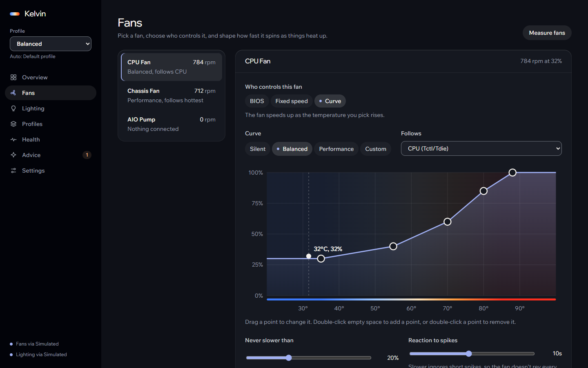
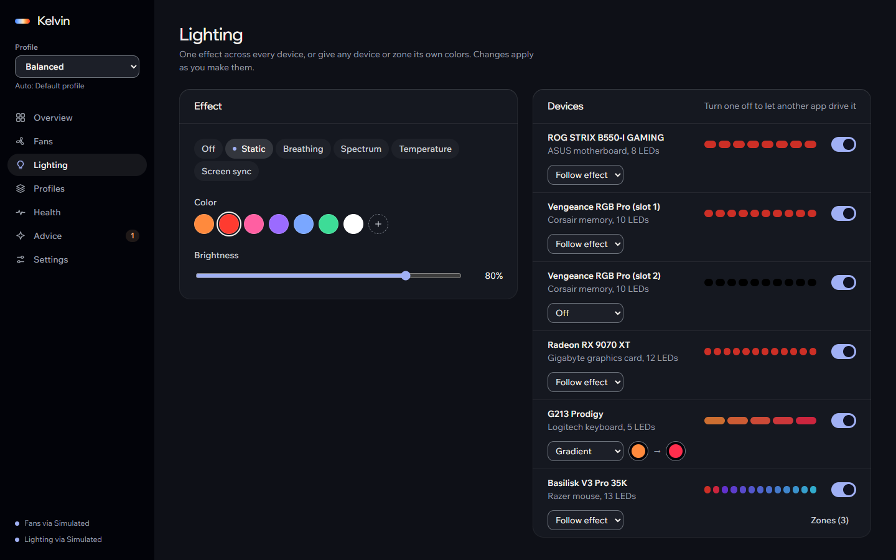

# Kelvin

**One clean app for your PC's fans and RGB lighting.** No more vendor suites fighting each other.

Kelvin reads your temperatures, runs your fans on curves you shape by dragging, and drives every RGB
device, whatever the brand, from one place. It measures the fans you actually have and suggests
settings for each one, with the reason.


## Why

Every brand ships its own app (Synapse, iCUE, Armoury Crate, G HUB, …). Run two and they fight
over the same devices: lighting flickers, settings reset, fan speeds jump. Kelvin replaces them with
one app that controls fans and lighting together, and tells you when something else is in the way.

## Features

- **Fan curves you can see.** Pick BIOS, a fixed speed, or a temperature curve per fan. Drag points on
  a chart that sits on a blue-to-red heat scale, and watch the live operating point move.
- **Smart setup.** *Measure fans* runs each fan from full speed to stopped (about 30 seconds) and
  records its real RPM range and stall point. *Advice* turns that into a suggested curve for each fan
  and explains why. For example: case fans follow the hotter of CPU and GPU in small builds, and
  Ryzen CPUs get a calmer response so fans don't rev at every spike.
- **Thermal health over time.** Kelvin learns how hot your CPU and GPU run at each load level and
  compares this week with a few weeks ago, like for like: *"At heavy load, your CPU runs 6°C hotter
  than 3 weeks ago. That usually means dust or drying thermal paste."* Temperatures are measured
  against the motherboard sensor, so a hot day doesn't look like dust, and changes you made to fan
  curves aren't mistaken for problems.
- **Lighting across brands.** One effect for every device: Static, Breathing, Spectrum, or
  **Temperature**, which shifts your whole PC from blue to red as it heats up. Or give any device,
  or any zone inside it (say, just the mouse's scroll wheel), its own solid color or gradient.
  Turn a device off to leave it to another app.
- **Temperature alerts.** Set your own limits ("CPU above 85°C for 10 seconds") and get a Windows
  notification when one is crossed, even while Kelvin sits in the tray. Short spikes are ignored
  and each episode notifies once, so it never nags.
- **Conflict detection.** Spots Razer Synapse, SignalRGB, Armoury Crate, iCUE, G HUB, Gigabyte Control
  Center and FanControl, and can close the lighting apps for you.
- **Runs in the background.** Close the window and Kelvin stays in the tray. Your fan curves keep
  running even when the app is closed. Optionally starts with Windows.
- **Keeps itself up to date.** Kelvin checks for new versions and installs them in under a minute.
  Every update is signed, and Kelvin refuses any that isn't.
- **One-click hardware reports.** Settings → *Report my hardware* opens a GitHub issue listing what
  Kelvin detected (board, fan chip, fans, sensors, RGB devices). You see all of it first, and it
  contains no serial numbers or personal details.

| Fans | Lighting | Health |
|---|---|---|
|  |  |  |


## Install

Download `Kelvin_x.y.z_x64-setup.exe` from [Releases](../../releases) and run it. That's all. The
installer sets up everything Kelvin needs:

- the Kelvin app and its background service (no separate .NET install needed);
- [OpenRGB](https://openrgb.org), shipped inside Kelvin, which runs it invisibly for lighting;
- the [PawnIO](https://pawnio.eu) driver for motherboard fans and RAM lighting, downloaded from its
  official release during install and checked against a pinned checksum.

Windows 10 or 11, 64-bit. Close other RGB and fan apps before using Kelvin; it will tell you if any are
still running. From 0.2.0 on, Kelvin updates itself; 0.1.0 needs a one-time manual reinstall.

## Safety

Fan control can damage hardware if it goes wrong, so Kelvin is built to fail safe:

- If the CPU or GPU reaches its limit (90°C / 95°C by default), every fan Kelvin controls goes to
  100%. On PCs where Kelvin can't control any fans (most laptops), it doesn't pretend to.
- If Kelvin stops, crashes, or loses a fan's temperature sensor, that fan goes back to BIOS control.
- Fans stay on BIOS control until you change them. Installing Kelvin changes nothing on its own.
- Curves are cleaned up on save: duty never drops as temperature rises, and the hot end reaches 100%.
- GPU fans are left to the graphics card unless you set them up yourself.
- The service listens on `127.0.0.1` only and rejects requests from web pages, so a website can't
  change your fans.

## How it works

```
 Kelvin desktop app (Tauri, Rust) ── window, tray icon, start with Windows
        │  HTTP + WebSocket, 127.0.0.1:5577
 Kelvin hardware service (.NET, Windows service) ── fan curves, safety, lighting effects, advice
        ├── LibreHardwareMonitor ── sensors and fan headers (via the PawnIO driver)
        └── OpenRGB SDK ─────────── RGB devices (Kelvin runs OpenRGB in the background)
```

Kelvin doesn't talk to hardware directly. It builds on two mature open-source projects, so it supports
whatever [LibreHardwareMonitor](https://github.com/LibreHardwareMonitor/LibreHardwareMonitor) and
[OpenRGB](https://openrgb.org) support. To add hardware they don't cover, implement `IFanProvider` or
`IRgbProvider` in `src/Kelvin.Hardware`.

## Build from source

You need the [.NET 10 SDK](https://dotnet.microsoft.com/download). For the desktop app and installer
you also need [Rust](https://rustup.rs), the Tauri CLI (`cargo install tauri-cli --version "^2" --locked`)
and Microsoft's C++ Build Tools.

Try Kelvin with simulated hardware. No admin needed, and nothing touches your PC:

```bash
dotnet run --project src/Kelvin.Service -- --simulate
```

Then open http://127.0.0.1:5577. Or run the desktop app, which starts the service for you:

```bash
cd desktop && cargo tauri dev
```

Build the installer (downloads pinned, checksum-verified OpenRGB and bundles everything):

```bash
./build-installer.ps1
```

Releases are built, signed and drafted by GitHub Actions when a version tag is pushed. See
[docs/RELEASING.md](docs/RELEASING.md).

Run the tests:

```bash
dotnet test
```

The screenshots come from demo mode (simulated hardware, no notices), which runs next to an installed
Kelvin on its own port:

```bash
dotnet run --project src/Kelvin.Service -- --demo --port 5580
```

## Project layout

| Path | What's in it |
|---|---|
| `src/Kelvin.Core` | Fan and lighting engines, advisor, settings, conflict detection, simulated hardware |
| `src/Kelvin.Hardware` | LibreHardwareMonitor and OpenRGB adapters, OpenRGB supervisor |
| `src/Kelvin.Service` | Local API, Windows service host, and the UI in `wwwroot` (no build step) |
| `desktop` | Tauri desktop app (Rust) and the NSIS installer hooks |
| `tests/Kelvin.Core.Tests` | Curve math, safety behaviour, advisor rules, thermal health, lighting, reports |
| `scripts`, `.github/workflows` | Update signing and the release pipeline |

## Status

Early, and working: tested on an ASUS ROG Strix B550-I with a Ryzen 7 5800X, a Radeon RX 9070 XT,
Corsair Vengeance RGB Pro RAM, and Razer and Logitech peripherals. Other boards should work wherever
LibreHardwareMonitor and OpenRGB do. Reports with your board model and what Kelvin detected are very
welcome. Please open an issue.

## License

[MIT](LICENSE). Third-party components keep their own licenses; see
[THIRD-PARTY-NOTICES.md](THIRD-PARTY-NOTICES.md).
